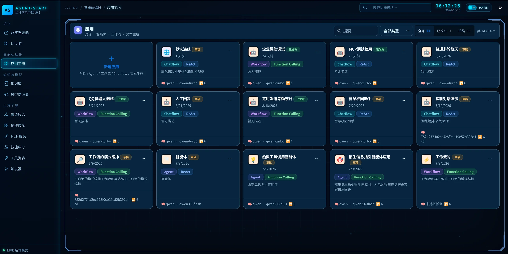
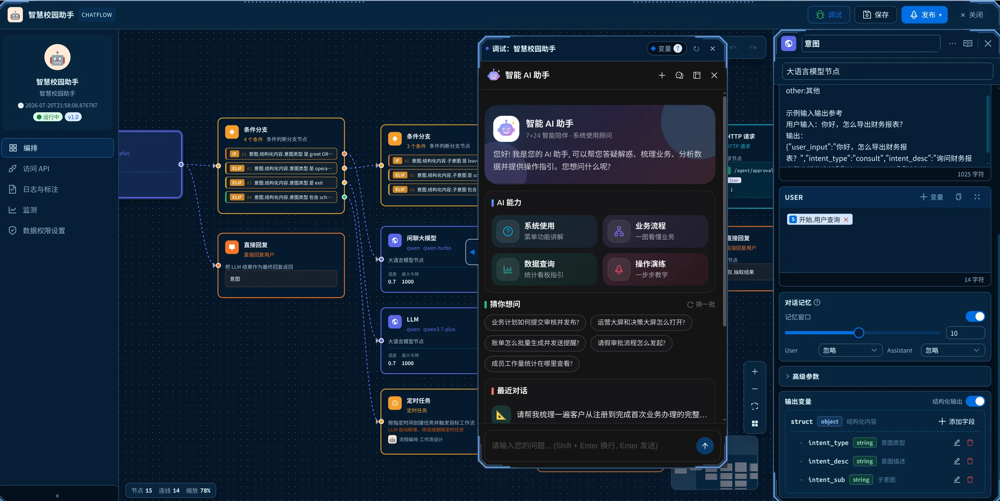
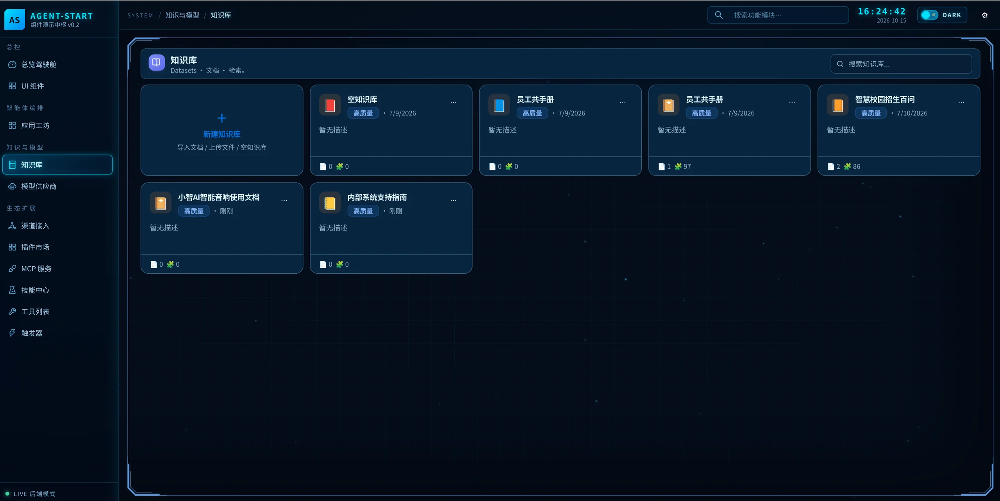
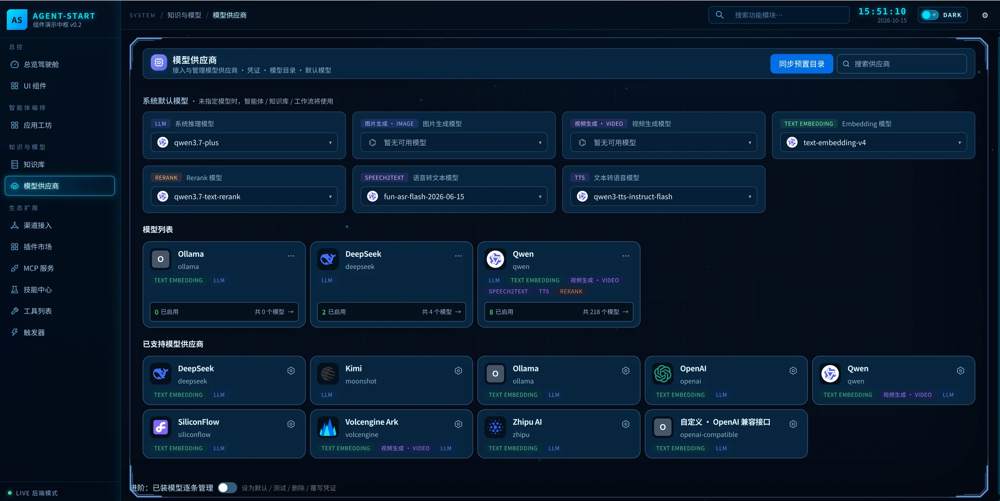
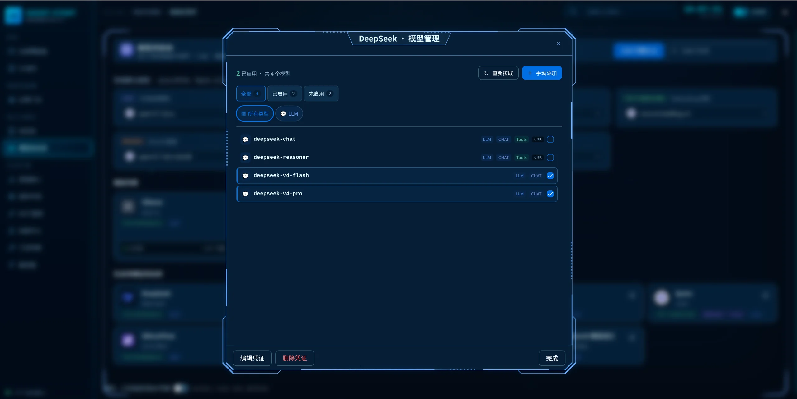
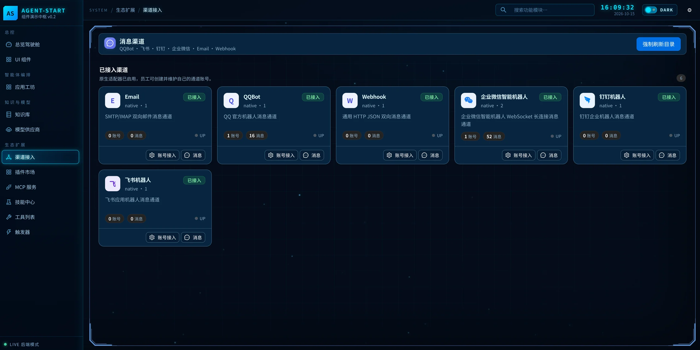
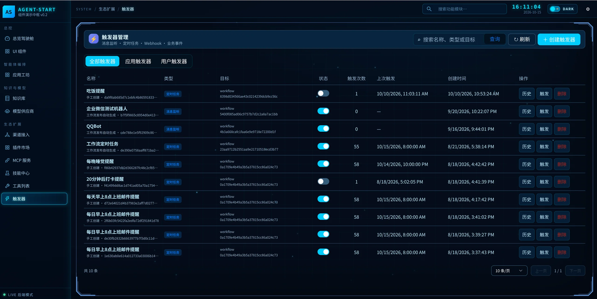

# AgentStart

**面向 Java / Spring 生态的 AI 应用开发与集成平台。**

AgentStart 将模型接入、智能体、可视化工作流、知识库检索、工具扩展、消息渠道与自动化触发整合到统一平台，帮助团队完成从应用构建、在线调试到发布接入的完整流程。

业务团队可以通过可视化界面配置对话助手和业务流程；开发团队可以通过模块化 Java SDK、Spring Boot Starter、HTTP API 与 Vue 组件库，将 AI 能力集成到现有系统中。平台支持独立服务部署，也支持按需组合模块，由宿主系统提供用户、租户与权限上下文。

[核心能力](#核心能力) · [产品界面](#产品界面) · [应用构建流程](#应用构建流程) · [本地运行](#本地运行) · [项目结构](#项目结构) · [开发文档](#开发文档)

## 核心能力

| 能力 | 平台支持 | 应用价值 |
| --- | --- | --- |
| 应用工坊 | 对话、Agent、Workflow、Chatflow、文本生成；草稿与发布版本管理 | 在统一入口创建、管理和交付不同类型的 AI 应用 |
| 可视化编排 | 节点画布、变量引用、条件分支、模型调用、HTTP 请求、直接回复与在线调试 | 将业务规则、模型推理和外部操作组织成可维护的流程 |
| 智能体运行时 | ReAct、Function Calling；NATIVE 与 AgentScope 运行适配 | 按任务需要组合模型、工具与上下文，执行多步骤任务 |
| 知识库与 RAG | 文档解析、分块、索引、召回编排、融合、重排与证据处理 | 为企业知识问答和业务助手提供检索上下文 |
| 模型管理 | 供应商凭证、模型目录、模型启用、默认模型与 OpenAI 兼容接入 | 集中管理模型资源，按应用需求选择模型能力 |
| 工具与生态扩展 | 工具执行网关、MCP、连接器、技能和业务插件 | 将外部服务与业务操作接入智能体和工作流 |
| 消息渠道 | 企业微信、QQBot、飞书、钉钉、Email、Webhook | 将应用接入团队已有的沟通与消息入口 |
| 自动化触发 | 定时任务、消息监听、Webhook 与业务事件；触发历史与手动触发 | 让应用响应消息、按计划执行或由业务事件驱动 |
| 状态与治理 | 工作流检查点与恢复、Agent 状态存储、审批恢复、工具权限与调用预算 | 为持续运行和受控执行提供基础能力 |
| 计量与集成 | 模型调用计量、费用聚合、趋势查询；HTTP 与流式 API | 支持运行分析，以及与现有业务系统连接 |

### 面向 Java 业务系统的集成方式

- **独立平台**：通过 `agentstart-server` 启动服务，配合管理前端完成配置、编排和调试。
- **嵌入式后端**：使用 Spring Boot Starter 和所需功能模块，在现有 Java 应用中装配 AI 能力。
- **嵌入式前端**：使用 Vue 3 组件库，将应用工坊、知识库、模型管理等页面嵌入宿主系统。
- **API 接入**：通过管理 API、业务 API 及 OpenAI / Dify 兼容对话与流式 API 对接调用方；具体覆盖范围以接口实现为准。

## 产品界面

以下为当前系统界面。截图中的应用、模型名称、数量与连接状态为示例环境数据；实际可用能力取决于已安装模块、供应商配置和渠道账号授权。

### 应用工坊：统一管理 AI 应用

应用工坊集中展示应用类型、执行模式、关联模型与发布状态，支持搜索、类型筛选，以及草稿和已发布应用的分类查看。团队可以从同一入口构建多轮对话、工具调用智能体、业务工作流和文本生成应用。



### 可视化编排：连接模型推理与业务流程

通过节点画布组织模型调用、条件分支、HTTP 请求和回复节点；在配置面板中设置提示词、输入变量、对话记忆与结构化输出。内置对话调试窗口支持边编排边验证交互效果，完成调试后保存并发布应用。

截图以智慧校园助手为例，展示意图识别、条件路由、不同模型节点与业务请求的组合方式。应用侧同时提供访问 API、日志与标注、监测及数据权限设置入口。



### 知识库：将业务文档转化为检索上下文

知识库集中管理文档资产与分块索引，提供新建知识库、导入文档、上传文件和搜索入口，展示文档数与分块数。后端将知识入库与 RAG 检索分层：知识模块负责解析、分块与索引，RAG 管线负责查询规划、召回、融合、重排和证据处理，供对话、工作流与 Agent 检索工具复用。

适用于员工手册、招生指南、产品说明、内部制度和系统操作文档等知识场景。



### 模型管理：统一配置供应商与模型资源

模型供应商页面统一管理供应商凭证、模型目录和系统默认模型，提供推理、Embedding、Rerank、语音识别、语音合成、图片与视频生成等模型类别的配置入口。各类别的实际调用能力由对应供应商和适配模块提供。

界面提供 Qwen、DeepSeek、OpenAI、Kimi、智谱、火山方舟、Ollama、SiliconFlow 及自定义 OpenAI 兼容接口等接入入口，便于按业务需求配置云端服务或兼容服务。



在单个供应商下，可以重新拉取目录、手动添加模型、筛选启用状态并维护凭证。模型目录与运行调用分离，供应商配置或目录同步后无需通过重启更新预置目录。



### 渠道接入：将应用带到业务沟通入口

消息渠道页面集中展示 Email、QQBot、Webhook、企业微信智能机器人、钉钉机器人与飞书机器人，提供账号接入和消息查看入口，并展示账号数、消息数和运行状态。

渠道模块负责消息接入、可信身份、应用路由与可靠投递。通过账号配置与应用绑定，可以将同一平台的智能体和工作流用于不同业务沟通场景。



### 触发器：让 AI 应用自动响应与执行

触发器管理支持按应用或用户查看任务，集中维护消息监听、定时任务、Webhook 和业务事件触发。列表展示目标流程、启用状态、触发次数及上次触发时间，并提供历史查看、手动触发与删除操作。

可用于定时统计、业务提醒、机器人消息处理，以及外部事件驱动的工作流执行。



## 应用构建流程

1. **接入模型**：配置供应商凭证，启用所需模型，并设置系统默认模型。
2. **准备知识与工具**：按场景导入业务文档，配置检索资源、工具、MCP 服务或连接器。
3. **创建应用**：在应用工坊选择应用类型，配置模型、提示词、上下文和执行模式。
4. **编排与调试**：为业务流程添加节点、变量和条件路由，在调试窗口验证输入输出。
5. **发布与接入**：发布应用版本，通过 API 或消息渠道提供服务；按需配置自动触发。
6. **跟踪与迭代**：结合运行日志、触发历史与模型调用计量调整应用配置。

## 典型场景

| 场景 | 能力组合 | 示例 |
| --- | --- | --- |
| 企业知识助手 | 知识库 + RAG + 多轮对话 | 制度查询、员工手册问答、产品使用咨询 |
| 业务办理助手 | 意图识别 + 条件路由 + 工具 / HTTP 请求 | 操作指引、业务查询、审批流程协助 |
| 智慧校园助手 | 招生知识库 + Chatflow + 业务连接 | 招生咨询、校内系统使用指引、信息查询 |
| 团队机器人 | Agent / Workflow + 消息渠道 | 企业微信、飞书、钉钉与 QQ 消息应答 |
| 定时业务自动化 | 触发器 + Workflow + 消息发送 | 统计汇总、周期提醒、定时通知 |
| 内容与工具助手 | 模型调用 + 技能 / 插件 + 工具网关 | 文本生成、多步骤工具调用、业务内容处理 |

以上为可基于平台能力搭建的应用方向，具体业务逻辑、数据权限和外部系统连接需按项目配置。

## 技术基础

- **后端**：Java 21、Maven 3.9+、Spring Boot、Spring AI，支持 AgentScope 运行适配。
- **前端**：Vue 3 组件库与管理演示项目，独立 React 对话前端；支持明暗主题与科技感外观。
- **数据与状态**：PostgreSQL、Redis；向量存储适配包括 pgvector、Elasticsearch、Milvus。
- **模块组织**：基础设施、执行引擎、知识与上下文、业务集成、接入层与独立服务；模型提供商、存储与渠道按模块扩展。

Maven 坐标为 `io.aigoodle:agentstart:0.1.0-SNAPSHOT`。具体依赖版本以根 `pom.xml` 为准，前端独立构建，不参与 Maven 聚合。

## 项目结构

根 POM 聚合 5 个职责分组和一级模块 `agentstart-server`；分组 POM 的 packaging 为 `pom`，同时作为子模块的父 POM。
功能模块使用 `agentstart-*` artifactId，可按需引用；聚合与继承不代表运行时依赖。
模型提供商、向量存储、平台渠道与业务插件分别使用独立聚合目录，避免核心模块强制引入全部 SDK。

```text
agentstart/
├── pom.xml
├── agentstart-foundation/                         # 基础设施
│   ├── agentstart-common/
│   ├── agentstart-persistence/
│   ├── agentstart-model/
│   ├── agentstart-observability/
│   └── agentstart-model-provider/                       # Qwen、DeepSeek、Volcengine、OpenAI、Kimi、智谱、自定义
├── agentstart-engine/                         # 执行引擎
│   ├── agentstart-agent/
│   ├── agentstart-tools/
│   ├── agentstart-runtime-agentscope/
│   ├── agentstart-agentscope-sdk/
│   └── agentstart-workflow/
├── agentstart-context/                         # 知识与上下文
│   ├── agentstart-knowledge/
│   ├── agentstart-rag/
│   ├── agentstart-memory/
│   ├── agentstart-skill/
│   ├── agentstart-store/                          # pgvector、Elasticsearch、Milvus
│   └── agentstart-rag-tools/                      # 检索工具适配
├── agentstart-integrations/                         # 业务集成
│   ├── agentstart-connector/
│   ├── agentstart-plugin/
│   ├── agentstart-channel/
│   ├── agentstart-trigger/
│   ├── agentstart-channel-redis/
│   ├── agentstart-connector-tools/
│   ├── agentstart-plugin-agent/
│   ├── agentstart-channels/                       # 轻量 SPI、原生运行时与平台适配
│   └── agentstart-plugins/                        # 示例、Seedance、统一视频插件
├── agentstart-access/                         # 接入层
│   ├── agentstart-api/                        # 公共 HTTP 契约与 JSON 树桥接
│   ├── agentstart-web/
│   ├── agentstart-completion/
│   ├── agentstart-spring-boot-starter/
│   └── agentstart-mcp-auth-spring-starter/         # MCP 服务端鉴权，可选
├── agentstart-server/                         # 独立服务启动模块
└── frontend/                       # 独立前端，不参与 Maven 构建
```

Java 版本、编码和构建插件集中在根 POM，分组内功能模块通过分组父 POM 继承，`agentstart-server` 直接继承根 POM。
分组内部也不自动互相依赖，依赖关系在实现时按实际需要声明。

## 模块职责

| 模块 | 职责 |
| --- | --- |
| `agentstart-common` | 共享值对象、错误协议与基础工具。 |
| `agentstart-persistence` | 宿主租户身份与持久化基础设施。 |
| `agentstart-model` | 模型目录、凭证、模型实例与调用计量接入。 |
| `agentstart-tools` | 工具契约、注册、权限与执行网关。 |
| `agentstart-agent` | 应用定义、发布版本与框架无关的 AgentRuntime 契约。 |
| `agentstart-runtime-agentscope` | AgentScope 执行适配、事件映射与 Agent 内部恢复。 |
| `agentstart-agentscope-sdk` | SDK 分发包；重定位 Jackson 2 Schema 库，避免与 Spring AI 冲突。 |
| `agentstart-knowledge` | 知识资产、文档解析、分块、索引与入库任务。 |
| `agentstart-rag` | 查询规划、召回编排、融合、重排与证据处理。 |
| `agentstart-workflow` | 业务 DAG、节点执行、检查点、租约与流程恢复。 |
| `agentstart-memory` | 长期记忆服务及存储适配；运行内上下文由 Runtime 管理。 |
| `agentstart-skill` | 技能目录、发布与渐进加载。 |
| `agentstart-connector` | 外部系统连接、凭证与受治理执行。 |
| `agentstart-plugin` | 业务插件契约、安装与运行适配。 |
| `agentstart-channel` | 消息渠道、可信身份、路由与可靠投递。 |
| `agentstart-trigger` | 定时、Webhook 与事件触发。 |
| `agentstart-observability` | 模型调用计量、费用聚合与趋势查询；业务观测适配归属对应上层模块。 |
| `agentstart-web` | 管理 API 与业务 API。 |
| `agentstart-completion` | OpenAI / Dify 兼容对话与流式 API。 |
| `agentstart-spring-boot-starter` | Spring Boot 自动配置与按需装配入口。 |
| `agentstart-server` | 独立服务启动模块。 |

## 运行时与集成边界

工作流负责流程调度与恢复；AgentScope Runtime 负责 Agent 内部执行与恢复。
RAG 管线统一供工作流、对话和 Agent 检索工具使用；知识模块管理入库与索引。
工具执行统一经过宿主权限网关；租户和用户身份由宿主提供。
框架无关模块不直接依赖 AgentScope，适配集中在 `agentstart-runtime-agentscope`。
服务模块已具备独立启动类与核心 HTTP 装配；默认连接 PostgreSQL。

目前已迁入 common、persistence、model、observability 的模型计量、tools、memory 与 skill。
RAG、knowledge、NATIVE Agent 运行时以及 connector、channel、plugin、workflow、trigger 已迁入并通过项目回归。
HTTP 接入与 server 核心装配已迁入并通过启动测试，Vue 组件库与 demo 构建通过。
可选提供商、存储、平台渠道和业务插件已迁入；server 已接回原有默认集成。
业务观测与评估分别归属工具、Agent、渠道模块；MCP 服务端鉴权使用独立 starter。
AgentScope 2.0.3 适配器可执行真实 ReActAgent；加入适配模块且已有模型和工具目录时自动提供默认工厂。
应用通过 `runtimeType=AGENTSCOPE` 选择该后端，`runtimeRef` 可指定宿主自定义工厂 Bean；未指定时使用默认或唯一工厂。适配器关闭每次调用创建的 Agent。
AgentScope 默认模型与治理工具工厂已提供；模型/工具调用预算已接入；运行状态与步骤已复用平台存储。
server 默认设置 `spring-agent.agentscope.state-store=jdbc`，SDK 会话状态使用带版本校验的数据库存储。
宿主可注入支持版本写入的 `AgentStateStore`；未配置 JDBC 的 SDK 宿主使用内存状态。审批支持持久化和重启恢复；已发布子应用委派沿用租户身份与治理网关，完整迁移状态见 [迁移计划](MIGRATION.md)。

独立 server 使用 WebFlux 文件上传适配；Servlet 宿主保留 MultipartFile 接口。
上传缓冲区上限由 `spring-agent.web.max-upload-size` 配置，默认 `100MB`；超限返回 HTTP 413。
WebFlux 下的同步 SDK 控制器在虚拟线程执行；宿主将可信身份放入 Reactor Context，接入层按调用范围恢复 ThreadLocal。
completion 可独立于 web 使用，共享 `agentstart-api` 的错误响应协议。

## 模型供应商配置

可选供应商模块统一位于 `agentstart-foundation/agentstart-model-provider`：
`agentstart-model-qwen`、`agentstart-model-deepseek`、`agentstart-model-volcengine`、
`agentstart-model-openai`、`agentstart-model-kimi`、`agentstart-model-zhipu`、`agentstart-model-openai-compatible`。
共享 OpenAI 兼容传输实现，各模块只注册供应商预置，避免重复客户端代码；Kimi 保留 `moonshot` 数据标识以兼容已有凭证。
前端模块与包子路径为 `model-provider-hub` / `vue-agent-start/model-provider-hub`。

启动不再同步供应商或预置模型数据库目录。保存供应商配置时只同步该供应商；
管理员可点击“同步预置目录”，或调用 `POST /agent-start/model-providers/catalog/sync`。
远程目录仅在配置时或手动拉取时访问；运行时客户端仍按实际调用惰性创建。
供应商列表使用请求内的租户快照，模型、凭证、启用设置各读取一次；不使用跨请求的凭证缓存。
业务与 Mapper 日志默认 INFO；排查模型 SQL 可临时设置 `logging.level.io.aigoodle.model.mapper=DEBUG`。

自定义卡片使用标准 OpenAI Chat Completions / Embeddings 接口，可配置 API Key 和必填 Base URL。
预置目录参考 [Kimi官方模型列表](https://platform.kimi.com/docs/models) 与 [智谱OpenAI兼容文档](https://docs.bigmodel.cn/cn/guide/develop/openai/introduction)，无需重启即可手动同步新增预置。

## 本地运行

### 环境准备

准备 JDK 21、Maven 3.9+、与前端 Vite 版本兼容的 Node.js 和 pnpm，以及可连接的 PostgreSQL、Redis。
在 `agentstart-server/.env.local` 中配置本地数据库、Redis 与所需密钥。服务启动时加载各模块数据库建表脚本，配置入口见 `agentstart-server/src/main/resources/application.yml`。

演示服务提供本地演示身份；接入业务系统时，应通过宿主的登录会话或 SSO 提供可信用户与租户上下文，并配置独立密钥。

### 启动后端

在仓库根目录构建并启动后台，脚本读取 `agentstart-server/.env.local`，支持引号和注释；不会执行 env 中的 shell 命令，也不会打印凭证。数据库和 Redis 地址使用该文件配置。

```bash
mvn -pl agentstart-server -am package -DskipTests
python3 scripts/run-server.py
```

### 启动管理前端

首次运行，先构建 Vue 组件库：

```bash
cd frontend/vue-agentstart
pnpm install --frozen-lockfile
pnpm build
```

另开终端启动真实后端 demo；Vite 默认使用 5173，`VITE_PORT` 可覆盖（当前本地配置为 5178）。端口被占用时以终端输出的地址为准。

```bash
cd frontend/agentstart-demo
pnpm install --frozen-lockfile
MOCK=false pnpm dev --host 127.0.0.1
```

### 启动对话前端

应用编辑页的对话预览使用独立 React 聊天前端，还需启动：

```bash
cd frontend/react-antdx-chat
pnpm install --frozen-lockfile
pnpm dev --host 127.0.0.1
```

聊天前端默认端口 5073，由 demo 的 `/chat/` 代理嵌入；两个前端均支持 `VITE_AGENT_API_TARGET` 配置后台地址。
组件库样式来自构建产物，修改组件库后需重新构建以更新 demo 引用的样式。

后台默认端口 18090，前端通过 `/api/agent-start` 代理访问。`VITE_AGENT_API_TARGET` 可设置其他后台地址。使用 Ctrl+C 停止各服务。

## 验证

```bash
mvn -B -T1 validate
mvn -B -T1 test
mvn -B -T1 spotless:check

# 修改 Java 代码后统一格式化
mvn -B -T1 spotless:apply

# 构建整个执行引擎分组
mvn -B -T1 -f agentstart-engine/pom.xml test

# 按 artifactId 构建单个功能模块及其依赖
mvn -B -T1 -pl :agentstart-runtime-agentscope -am test
```

功能模块按需包含 Java、资源及测试目录；聚合模块只管理子模块与继承。

## IDEA 导入

打开仓库根目录的 `pom.xml` 并作为 Maven 项目加载，Maven 工具窗口执行 Reload All Maven Projects。
移动模块后，如有旧路径的单独关联，先解除旧关联，再关联根 POM。
各聚合模块的目录名、artifactId 和 name 保持一致；知识与上下文聚合为
`agentstart-context`，避免与功能模块 `agentstart-knowledge` 重名。
项目 SDK 与 Maven 导入器使用 JDK 21。

## 开发文档

| 文档 | 内容 |
| --- | --- |
| [Vue 组件库](frontend/vue-agentstart/README.md) | 组件安装、全局配置与宿主集成 |
| [前端外观配置](frontend/vue-agentstart/APPEARANCE.md) | 主题切换、科技感外观与 CSS 变量 |
| [渠道集成](frontend/vue-agentstart/CHANNEL-HUB.md) | 渠道组件与接入说明 |
| [连接器集成](frontend/vue-agentstart/CONNECTOR-HUB.md) | 外部系统连接组件说明 |
| [对话前端](frontend/react-antdx-chat/README.md) | 独立聊天界面与开发说明 |
| [AgentScope SDK](agentstart-engine/agentstart-agentscope-sdk/README.md) | SDK 分发与依赖集成 |
| [迁移与验证记录](MIGRATION.md) | 模块迁移、架构调整及历史验证范围 |

### 文档参考

延伸阅读：[Dify 官方文档](https://docs.dify.ai/)。AgentStart 的能力说明以本仓库实现和当前界面为依据。

## 许可证

本项目采用 [Apache License 2.0](LICENSE)，允许商业使用、修改和分发，无须另行申请商业授权；使用时须遵守许可证条款。第三方材料继续适用各自的许可证。
